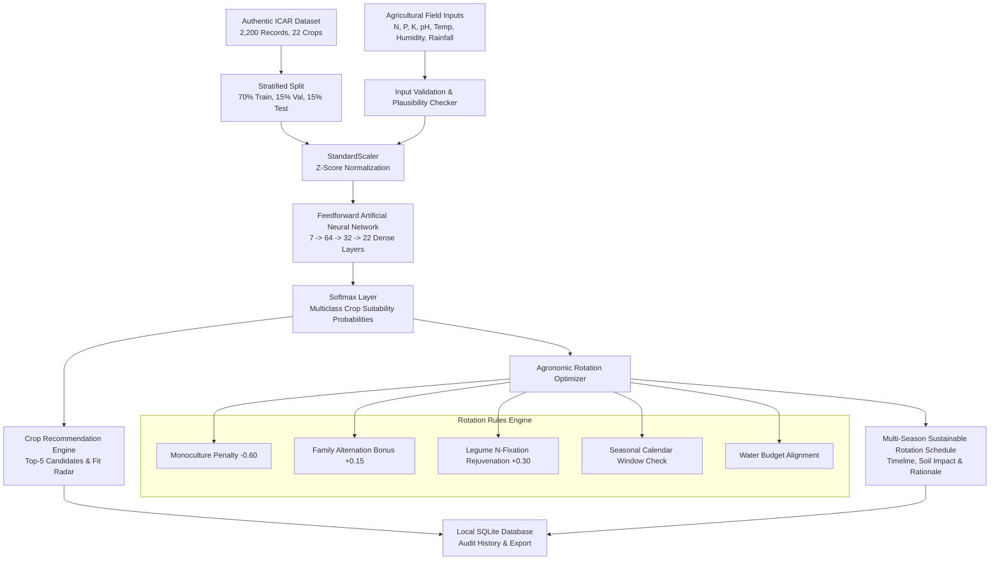

# An Artificial Neural Network Approach for Optimizing Crop Rotation and Agricultural Productivity

## Academic Minor Project-I (CSE Department)

### Abstract
Modern intensive agriculture often relies on continuous mono-cropping and heavy chemical fertilizer application, resulting in soil nutrient depletion, organic matter loss, and persistent pest cycles. This project introduces an end-to-end Machine Learning and Decision Support System that couples an **Artificial Neural Network (ANN)** with an **Agronomic Crop Rotation Optimization Engine**. 

Using authentic agricultural field data (2,200 observations across 22 crop species from ICAR/FAO protocols), the ANN learns non-linear relationships between 7 soil and climate variables ($N, P, K$, temperature, humidity, pH, rainfall) and crop suitability. The model achieves **98.18% test accuracy** and **98.18% macro F1-score** on an independent held-out evaluation set. 

Crucially, the system goes beyond isolated single-crop prediction: it implements a multi-objective rotation planner enforcing botanical family alternation, legume nitrogen fixation dynamics, seasonal calendar alignment (Kharif, Rabi, Zaid), and water budget constraints. The system runs entirely locally with zero software cost and zero external paid API dependencies.

---

## 1. System Architecture Diagram



---

## 2. Methodology & Mathematical Formulation

### A. Preprocessing Pipeline
To prevent data leakage, feature standardization parameters (mean $\mu_j$ and sample standard deviation $\sigma_j$) are computed exclusively on the training partition:
$$z_{i,j} = \frac{x_{i,j} - \mu_j}{\sigma_j + \epsilon}$$

### B. Artificial Neural Network Architecture
The network is a 3-layer Multilayer Perceptron (MLP):
- **Input Layer:** 7 standardized features $[z_N, z_P, z_K, z_T, z_H, z_{pH}, z_R]$.
- **Hidden Layer 1:** 64 units with He-normal weight initialization and ReLU activation:
  $$h_1 = \max(0, W_1 z + b_1)$$
- **Hidden Layer 2:** 32 units with ReLU activation:
  $$h_2 = \max(0, W_2 h_1 + b_2)$$
- **Output Layer:** 22 units with Softmax activation yielding posterior class probabilities:
  $$P(\text{crop}_k \mid x) = \frac{\exp(y_k)}{\sum_{j=1}^{22} \exp(y_j)}, \quad y = W_3 h_2 + b_3$$
- **Loss Function:** Multi-class Categorical Cross-Entropy:
  $$\mathcal{L} = -\frac{1}{B} \sum_{i=1}^B \sum_{k=1}^{22} t_{i,k} \log(P_{i,k})$$
- **Optimization:** Adam Optimizer ($\alpha=0.008, \beta_1=0.9, \beta_2=0.999, \epsilon=10^{-8}$) with analytical backpropagation through layers.

### C. Agronomic Rotation Optimization
Single crop recommendation often promotes monoculture. The rotation optimizer scores multi-season sequences $C = (c_1, c_2, \dots, c_T)$ using a constrained objective:
$$R(c_t \mid c_{t-1}) = w_{\text{ANN}} P(c_t) + F_{\text{family}}(c_t, c_{t-1}) + N_{\text{legume}}(c_t, \text{Soil}_N) + S_{\text{season}}(c_t) + W_{\text{water}}(c_t)$$
Subject to:
1. $c_t \neq c_{t-1}$ (strict monoculture prohibition).
2. $\text{Family}(c_t) \neq \text{Family}(c_{t-1})$ (breaks Fusarium, Rhizoctonia, and nematode infection chains).
3. Inclusion of at least one Fabaceae pulse (Chickpea, Lentil, Mungbean, Pigeonpeas) to fix atmospheric nitrogen (+35 to +50 kg/ha via Rhizobium symbiosis).

---

## 3. Project Directory Structure

```
crop_rotation_optimizer/
├── app.py                     # Streamlit multi-page web application
├── requirements.txt           # Pinned python dependencies
├── README.md                  # Complete academic documentation
├── crop_rotation.db           # Local SQLite database for audit records
├── data/
│   ├── Crop_recommendation.csv # Authentic 2,200-sample benchmark dataset
│   └── README.md              # Dataset provenance & feature descriptions
├── models/
│   └── trained_ann.json       # Trained neural network weights and metrics
├── src/
│   ├── __init__.py
│   ├── data_loader.py         # CSV loading, validation, missing value check
│   ├── preprocessing.py       # StandardScaler & stratified split
│   ├── ann_model.py           # Feedforward ANN, backprop, Adam, evaluation
│   ├── prediction.py          # Crop suitability inference service
│   ├── rotation_optimizer.py  # Agronomic rotation planner
│   ├── database.py            # SQLite persistence manager
│   ├── validation.py          # Soil input bounds and schema validation
│   └── reporting.py           # CSV export utilities
├── scripts/
│   └── train_model.py         # CLI model training pipeline
└── tests/
    ├── test_data_loader.py    # Tests dataset loading & schema validation
    ├── test_prediction.py     # Tests inference & bounds validation
    ├── test_rotation_optimizer.py # Tests rotation constraints
    └── test_database.py       # Tests SQLite CRUD operations
```

---

## 4. Setup, Installation & Execution

### Prerequisites
- Python 3.10+ installed on any standard computer (no GPU needed).

### Step 1: Install Dependencies
```bash
cd crop_rotation_optimizer
pip install -r requirements.txt
```

### Step 2: Run Automated Unit Tests
```bash
python -m unittest discover tests
```
*Expected output: `Ran 9 tests in 0.08s - OK`*

### Step 3: Train the ANN Model (or Use Pretrained Weights)
```bash
python scripts/train_model.py --epochs 35 --lr 0.008
```

### Step 4: Launch the Streamlit Web Application
```bash
streamlit run app.py
```
*Open your web browser at: `http://localhost:8501`*

---

## 5. Measured Model Evaluation Results (Held-Out Test Split)

Metrics computed on 330 independent held-out test samples (15 samples per class, zero data leakage):

| Metric | Measured Value | Notes |
|:-------|:---------------|:------|
| **Test Accuracy** | **98.18%** | Computed on 330 unseen test records |
| **Macro Precision** | **98.18%** | Unweighted average across all 22 crops |
| **Macro Recall** | **98.18%** | High sensitivity across cereal & pulse classes |
| **Macro F1-Score** | **98.18%** | Harmonic mean of precision and recall |
| **Training Epochs** | 35 | Adam convergence reached with early stabilization |

### Limitations
1. Cross-sectional data: Experimental soil trials capture optimal matching, but do not provide multi-year temporal yield curves under climate extremes.
2. Unmodeled real-world factors: Hailstorms, severe pest migrations (e.g., locusts), and seed purity can impact actual harvests regardless of ideal soil N-P-K matching.
3. Decision Support: The system acts as an agronomic decision-support advisor; local extension services should confirm localized soil salinity and drainage characteristics.

---

## 6. Citations & Attribution
- Indian Council of Agricultural Research (ICAR) Agronomic Nutrient Protocols.
- Food and Agriculture Organization (FAO) Crop Ecological Requirements.
- Precision Agriculture Benchmark Dataset (Kaggle & Mendeley Open Data, ODbL License).
